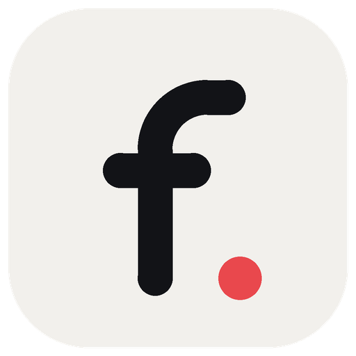
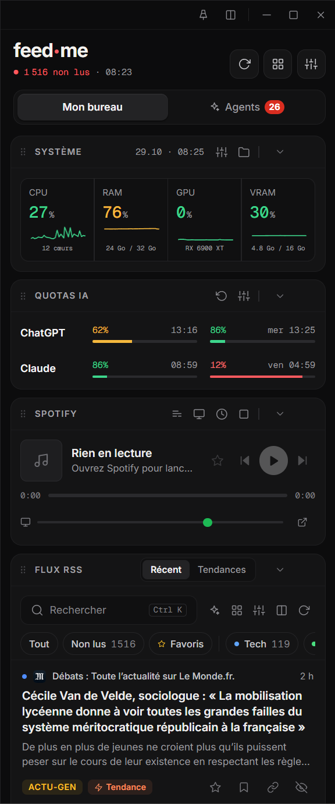
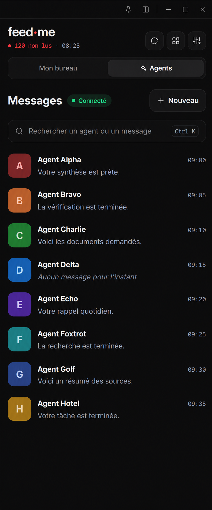
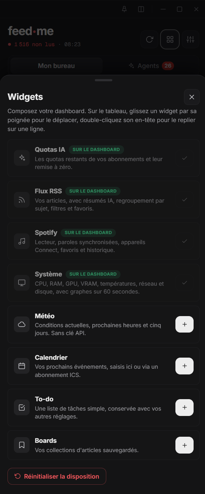
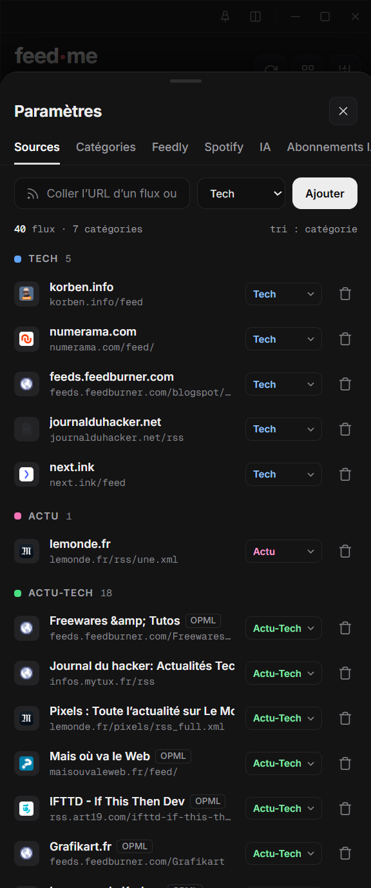
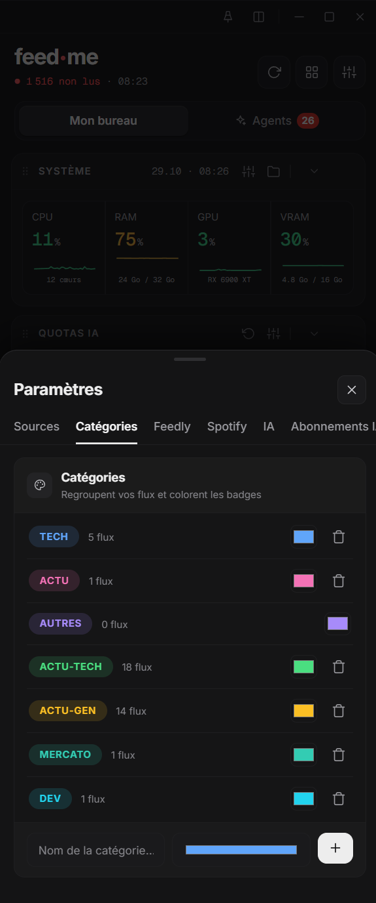

<div align="center">
  
  <h1>FeedMe</h1>
  <p><strong>Votre veille, vos widgets et vos agents. Un seul espace sur Windows.</strong></p>
  <p>Un tableau de bord modulable et une messagerie pour retrouver vos assistants au même endroit.</p>
  <p>
    
    
    
  </p>
  <p><a href="#aperçu">Aperçu</a> · <a href="#fonctionnalités">Fonctionnalités</a> · <a href="#démarrage-rapide">Démarrage rapide</a> · <a href="#connecter-ses-agents">Connecter ses agents</a></p>
</div>

## Aperçu

<table>
  <tr>
    <th width="33%">Votre bureau</th>
    <th width="33%">Vos agents</th>
    <th width="33%">Vos widgets</th>
  </tr>
  <tr>
    <td valign="top"></td>
    <td valign="top"></td>
    <td valign="top"></td>
  </tr>
</table>

<sub>Captures de l’application en disposition compacte. La capture Agents a été retouchée pour anonymiser les noms, avatars et messages : les informations affichées sont fictives. Cliquez sur une image pour la voir en grand.</sub>

## Fonctionnalités

### Un bureau à composer

Ajoutez les widgets dont vous avez besoin, déplacez-les par leur poignée et double-cliquez sur leur en-tête pour les replier. Votre disposition est conservée entre les sessions.

| Widget | Ce que vous retrouvez |
| --- | --- |
| **Flux RSS** | Sources personnalisées, import OPML et Feedly, recherche, catégories, favoris, filtres et résumés IA selon la configuration. |
| **Quotas IA** | Suivi des quotas disponibles et de leur remise à zéro, selon les abonnements et connexions pris en charge. |
| **Spotify** | Lecture, volume, appareils Connect, favoris, historique et paroles selon leur disponibilité. |
| **Système** | CPU, RAM, GPU, VRAM, températures, réseau et disque, avec graphiques selon les métriques disponibles. |
| **Météo** | Conditions actuelles et prévisions, sans clé API. |
| **Calendrier** | Événements locaux et abonnements ICS. |
| **To-do** | Tâches à cocher et conservation locale. |
| **Boards** | Collections d’articles sauvegardés, avec notes et extraits. |

### Une messagerie pour vos assistants

- **OpenClaw** via sa passerelle WebSocket, avec approbation de l’appareil.
- **Hermes** et **API compatibles Chat Completions** via leur adresse et leur jeton.
- Une liste d’agents avec recherche, aperçus, compteurs de messages non lus et profils personnalisables.
- Des conversations conservées localement, des pièces jointes et la réception des réponses en continu.
- Pour OpenClaw, sélection du modèle et récupération des conversations accessibles sur la passerelle.
- Une application qui reste près de l’horloge Windows lorsque vous fermez sa fenêtre.

Les détails de réception, de synchronisation et les limites connues sont décrits dans [le guide OpenClaw](OPENCLAW-RECEPTION.md).

### Une veille organisée

Classez vos sources par catégorie, choisissez leurs couleurs et retrouvez vos articles depuis le même tableau de bord.

<details>
<summary><strong>Voir les réglages des sources et des catégories</strong></summary>
<br>
<table>
  <tr><th width="50%">Sources RSS</th><th width="50%">Catégories et couleurs</th></tr>
  <tr>
    <td valign="top"></td>
    <td valign="top"></td>
  </tr>
</table>
</details>

## Démarrage rapide

### Lancer depuis les sources

**Prérequis :** Windows, Git et Node.js **22 ou ultérieur** avec npm.

```sh
git clone https://github.com/GGZDEV/FeedMe.git
cd FeedMe
npm ci
npm run widget
```

Dans **Mon bureau**, ouvrez la bibliothèque de widgets avec l’icône en grille. Dans **Agents**, utilisez **Nouveau** pour ajouter une connexion.

### Construire la version portable

```sh
npm run build
```

L’exécutable est créé dans **`dist/FeedMe.exe`**. Fermez toute version en cours d’exécution avant de reconstruire. Les exécutables et les dépendances installées ne sont pas inclus dans le dépôt.

### Ouvrir l’interface dans un navigateur

```sh
npm start
```

Le serveur écoute sur `127.0.0.1:3777`, ou sur le prochain port disponible. Consultez l’adresse affichée au démarrage. **La version bureau est nécessaire pour le stockage sécurisé utilisé par OpenClaw.**

## Connecter ses agents

| Connexion | Adresse à renseigner | Authentification |
| --- | --- | --- |
| **OpenClaw** | `wss://votre-passerelle.example.com` | Mot de passe de la passerelle, puis approbation de FeedMe côté OpenClaw. |
| **Hermes** | Adresse HTTPS de l’API, par exemple `https://agents.example.com/v1` | Jeton de l’API et modèle disponible, par exemple `hermes-agent`. |
| **API compatible** | Adresse HTTPS compatible Chat Completions | Jeton et identifiant du modèle du fournisseur. |

### OpenClaw

1. Ajoutez une connexion de type **OpenClaw** dans **Agents**.
2. Renseignez l’adresse WebSocket et le mot de passe, puis lancez la connexion.
3. Au premier accès, approuvez l’appareil **FeedMe** sur votre passerelle.
4. Relancez la vérification dans FeedMe pour terminer la connexion.

FeedMe conserve une identité d’appareil et utilise les droits `operator.read` et `operator.write`. Il ne s’accorde pas de droits d’administration. OpenClaw utilise ici **WebSocket**, sans activer l’API HTTP Chat Completions.

### Hermes et autres API

Activez l’API sur votre serveur, puis renseignez son adresse, son jeton et le modèle dans FeedMe. Les adresses avec un préfixe de profil sont acceptées. Pour un serveur distant, utilisez HTTPS ; HTTP est réservé à une connexion locale, par exemple via un tunnel SSH.

## Configurer les services

- **RSS / Feedly** : ouvrez les paramètres pour ajouter une URL de flux, importer un fichier OPML ou connecter Feedly.
- **Spotify** : copiez `spotify-app.example.json` vers `spotify-app.json` et renseignez votre identifiant client public. Vous pouvez aussi définir `SPOTIFY_CLIENT_ID`. Connectez ensuite votre compte dans l’interface.
- **IA** : choisissez votre fournisseur et ses paramètres dans l’onglet IA. Les fonctions disponibles dépendent du fournisseur et du modèle configurés.
- **Calendrier** : ajoutez vos événements ou l’URL d’un abonnement ICS depuis le widget.

## Données et confidentialité

Les données personnelles ne sont pas fournies avec les sources : chaque installation configure ses connexions et crée ses propres fichiers locaux.

| Mode | Emplacement des données |
| --- | --- |
| Développement | Dossier du projet, sauf si `FEEDME_DATA_DIR` est défini. |
| Application portable compilée | `%APPDATA%\feedme\FeedMe-data` |

Dans la version bureau, les identifiants des agents et leur identité d’appareil sont protégés par le stockage sécurisé Windows. **L’historique des conversations reste lisible dans les fichiers locaux.** Les autres services peuvent également conserver des jetons locaux : ne partagez pas votre dossier de données.

Le `.gitignore` exclut les fichiers JSON locaux, les secrets d’environnement, les caches, `node_modules/` et `dist/`. Seuls les exemples de configuration destinés au dépôt sont versionnés.

> Arrêter la réception dans FeedMe ne garantit pas l’arrêt d’un travail déjà lancé sur un serveur distant. Supprimer une conversation locale ne supprime pas sa session distante.

## Développement

| Commande | Usage |
| --- | --- |
| `npm run widget` | Lancer l’application Electron. |
| `npm start` | Lancer le serveur local et l’interface web. |
| `npm test` | Exécuter les tests avec des passerelles simulées. |
| `npm run build` | Produire l’exécutable portable Windows. |

`PORT` permet de choisir le port du serveur ; `FEEDME_DATA_DIR` permet d’isoler les données d’une session.

```text
FeedMe/
├── electron.js / preload.js     Application bureau et pont avec l’interface
├── server.js                   Serveur local et API des widgets
├── agents.js / openclaw.js      Connexions et conversations des agents
├── agent-*.js                  Contacts, boîte de réception et pièces jointes
├── ai*.js / direct-usage.js     Fonctions IA et suivi d’utilisation
├── public/                     Interface, styles et widgets
├── tests/                      Tests automatisés
├── build/                      Icône de l’application
└── docs/screenshots/           Captures pour la documentation
```

Un problème ou une idée ? [Ouvrir une issue](https://github.com/GGZDEV/FeedMe/issues).
